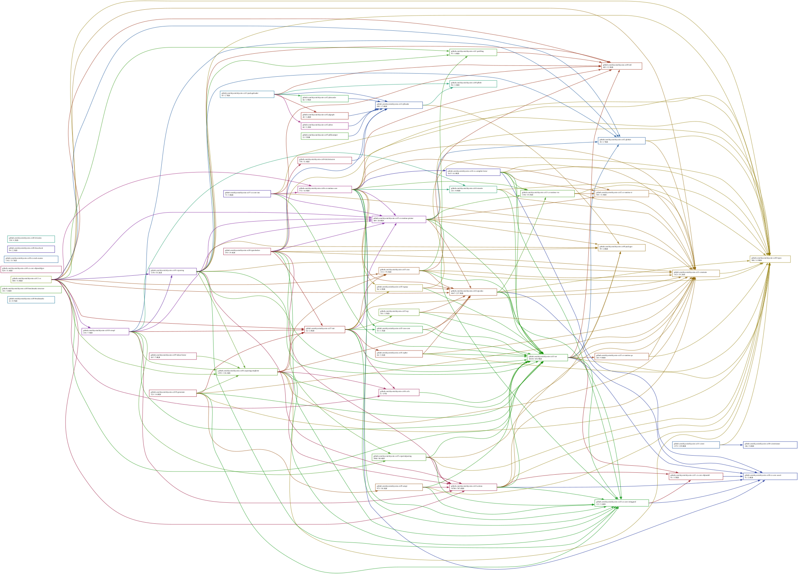

# CX Programming Language

[](https://github.com/skycoin/skycoin-cx/actions/workflows/check.yml)

CX is a general purpose programming language with a strict type system and a
syntax close to Go's. This repository holds its compiler, which is written in
Go, the two loops that run a compiled program, and `cx build`, which turns a
program into one executable file. By default a built program is a CX core
binary with the compiled program appended. `cx build --target=llvm` compiles a
program to LLVM IR instead and, with clang, to a native executable.

The language is described in [LanguageGuide.md](LanguageGuide.md) and the
changes in [CHANGELOG.md](CHANGELOG.md). The rules of this repository are in
[AGENTS.md](AGENTS.md) and [docs/Conventions.md](docs/Conventions.md).

## Install

CX needs Go 1.27.3 or newer, as go.mod requires, and `make`. On Windows use
Git Bash or MSYS2, so `make` and the check scripts have a shell.

```
git clone https://github.com/skycoin/skycoin-cx
cd skycoin-cx
make build
```

This puts `cx` and the `cx build` cores (`cx-core`, `cx-core-file` and the
rest) in `bin/`. Add that directory to your `PATH` to run `cx` from anywhere.
To update, `git pull` and `make build` again.

`go install github.com/skycoin/skycoin-cx/t11-cx-command-cx@latest` also works, but it
installs the binary as `t11-cx-command-cx` and builds no cores, so `cx build` needs the
cores from `make build`.

## Hello world

```
package main

import "sys/string"

func main() {
	string.PrintLine("Hello World!")
}
```

Save it as `hello.cx` and run `./bin/cx hello.cx`. More programs are in
`tests/examples`. `cx --help` lists the flags.

## Build options

`make build` builds cx with the cipher, os and regexp packages. Leave any of
them out with `TAGS=nocipher`, `TAGS=nocxos` or `TAGS=noregexp`, and
`TAGS=ptr64` switches CX to 64 bit pointers.

`make build-gui` adds the `gl`, `glfw` and `al` packages (cxfx). It needs cgo
and the GL, X11 and OpenAL headers. On Debian or Ubuntu:

```
sudo apt-get install libgl1-mesa-dev xorg-dev libopenal-dev xvfb
make build-gui
```

The OpenGL programs in `tests/examples/opengl` need this build.

## The language today

The language has versions. The current one is
`constants.LanguageVersionCurrent` in `t1-cx-core-opcodetable/constants.go`,
2611230003, an integer of the form `yymmddnnnn`. It is stored in every
serialized program, and a program serialized under another version must be
compiled again. Each version is described in
[Language versions](LanguageGuide.md#language-versions). The main changes
since skycoin/cx are these.

- Built-in libraries live under `sys/` and need an explicit import, as
  `import "sys/string"` and `import "sys/os"`. Their functions have verbose
  names such as `string.Concatenation`.
- Strings have no operators. `==`, `<`, `+` and the others on `str` are
  compile errors that name the function to use instead.
- A function declares the globals it uses in a `global` statement at the
  top of its body, `global counter, config.Limit`, and reaches a global of
  another package only as `package.name`.
- Shadowing is a compile error. A local with the name of a global, a
  package, a function, a type or a variable of an enclosing block is
  reported.
- A package is imported by its path and its members are used as
  `package.name`. See [Packages](LanguageGuide.md#packages).
- `import "pkg"` gives qualified names only. `import . "pkg"` and
  `import (A, B) "pkg"` also bring all or the listed names into the scope
  of the package, and `import file . "pkg"` and `import file (A, B) "pkg"`
  into the scope of the file. A name brought in that masks another name is
  a compile error, and `//cx:masking warning` before a function makes it a
  warning in that function. See
  [Imports into scope](LanguageGuide.md#imports-into-scope).
- Every independent compile error is reported once, as `file:line:column`,
  sorted by position. The compiler does not stop at the first error.

```
error: err.cx:6:2 function 'f' uses global 'g' without declaring it, add global g at the top of its body
error: err.cx:10:6 'g' shadows global declared at err.cx:3:5
error: err.cx:11:7 identifier 'undefinedthing' does not exist
```

An affordance selects a part of the running program for `serialize`, the
whole program, a memory segment, a package, a function, a struct or a
variable, written as an aff literal such as `#{pkg(main) fn(main) var(x)}`.
See [Affordances](LanguageGuide.md#affordances).

## System libraries

File access, networking and `os.Run` are system libraries, `file`, `net` and
`process`. They are disabled unless `--enable` names them, decision D17 of
[#492](https://github.com/skycoin/skycoin-cx/issues/492). A call into a
library that is not enabled is the runtime error
`CX_RUNTIME_LIBRARY_DISABLED`.

```
cx --enable=file,net program.cx
```

File paths are relative and confined to the working directory, or to the
directory `--sandbox` names. See
[System libraries](LanguageGuide.md#system-libraries).

## How a program runs

cx parses and compiles the source into the CX IR, then lowers it to a flat
image. There are two loops that run a program.

- The old loop walks the CX IR. It runs every program. Once
  `execute.RunPrepare` has sized its buffers it makes no Go allocation while
  it runs, outside printing composite values, the system libraries, the
  growth of the heap and the CX collector, which `TestRunAllocs` and
  `TestRunNoGC` check. See
  [docs/RunPathAllocations.md](docs/RunPathAllocations.md).
- The vm (`t3-cx-runtime-vm`) runs the lowered image in one switch loop. It
  makes no Go allocation while it runs, which `TestRunVmAllocs` checks. It
  runs a program only when every function lowers, and the lowering does not
  yet cover slices, the heap or most library calls.

`cx --executor=auto`, the default, runs a program on the vm when it lowers
and on the old loop otherwise. `--executor=old` and `--executor=vm` force
one loop, and vm fails on a program that does not lower. `TestLowerCompare`
runs every program that lowers on both loops and compares the memory after
them. See "The runtime image" in [docs/IR.md](docs/IR.md#the-runtime-image).

The garbage collector runs as a tick of the old loop, between steps, never
inside an opcode. The vm and the IR base do not reach it, which
`make check-gcreach` checks. See
The heap has a fixed cap, 64M unless `-heap-max` sets another, and the
heap, the collector scratch and its root table are allocated once when the
program is loaded (D42). A program that needs more stops with the runtime
error `CX_RUNTIME_HEAP_EXHAUSTED_ERROR`, "out of memory", naming the request
and the cap. `cx build -heap-max 256K` stores the cap in the built program,
so a target with little memory can run with a small heap.
[docs/GarbageCollector.md](docs/GarbageCollector.md).

A compiled program can be serialized and loaded again. The format is in
[docs/IR.md](docs/IR.md).

Each test program has an execution record, the hashes of the program, its
input and its output and the exit code, in
[tests/execution-records.txt](tests/execution-records.txt).
`TestExecutionRecords` runs every record on the old loop, on vm, after a
round trip through the serialized program on both loops, as an executable
from `cx build`, and as a native executable from `cx build --target=llvm`,
and each must give the recorded result. See
[docs/ExecutionRecords.md](docs/ExecutionRecords.md).

## cx build

`cx build` turns a program into one executable file.

```
./bin/cx build hello.cx    # writes hello, as go build, or name it with -o
./hello
```

The file is a core binary from `bin/` with the serialized program and a
trailer appended. At start up the core reads the program from the end of its
own file and runs it, on the vm when it lowers and on the old loop otherwise,
and passes its command line arguments to the program as `os.Args`. On
Windows name the output `hello.exe`. `--core path` gives another core or a
directory of cores.

The core has no parser and loads no source. It links a system library only
when the program calls it and `--enable` enables it, so `make build` builds
one core per set of libraries, `cx-core` for none, `cx-core-file`,
`cx-core-file-net` and so on. `cx build --enable=file program.cx -o program`
picks `cx-core-file`, and the built program runs with exactly the libraries
it was built with. `cx build` refuses a program that uses an opcode the core
leaves out, such as `gl`. The heap cap given with `-heap-max` is stored in
the built program. Only a core with the cipher library links a Go
module outside the standard library, the `cipher` package of Skycoin.
See [Building an executable](LanguageGuide.md#building-an-executable).

`cx build --target=llvm program.cx -o program` compiles a program that runs
on vm to LLVM IR, `program.ll`, and with clang to a native executable that
prints what vm prints. See [docs/LlvmTarget.md](docs/LlvmTarget.md).

## Performance

`t0-cx-tools-benchmarks/compare` holds twelve long benchmarks, each in CX and
pure Go with the same algorithm, six of them in Python 3 and Bash too, and
each prints a hash of its results that `TestCompareExpected` derives from the
math. `make bench-compare` times them and needs python3, taskset and, for the
native column, clang. It is not part of `make check`. The numbers below are
in milliseconds with the start up time taken off, the median of 3 runs pinned
to one core.

| benchmark | cx vm | Go |
|---|---:|---:|
| count | 838 | 18.0 |
| fib | 1186 | 35.8 |
| array | 857 | 6.9 |
| struct | 974 | 6.6 |
| memtest | 1396 | 26.4 |
| primes | 792 | 66.4 |
| ackermann | 957 | 71.8 |
| digitalroot | 969 | 20.2 |
| factorialiter | 982 | 19.0 |
| factorialrec | 966 | 15.3 |
| structs | 939 | 15.6 |
| structserialize | 974 | 7.7 |

See [t0-cx-tools-benchmarks/README.md](t0-cx-tools-benchmarks/README.md).

## Tests and checks

- `make check` runs every check below, `go vet` and gofmt, the Go tests, and
  the stable CX program tests with a default and a `ptr64` build. CI runs it
  on Linux, macOS and Windows.
  - `check-tiers`, a package imports only packages of lower tiers.
  - `check-inits`, no `func init()` outside package main.
  - `check-ifaces`, no interface embeds another interface.
  - `check-recovers`, no `recover(` outside `vendor/`.
  - `check-objmodel`, the object model rules and up to date generated
    managers.
  - `check-gcreach`, the vm and the IR base stay free of the garbage
    collector.
  - `check-strhot`, every string operation on the run path of the old loop
    has a STRHOT code, see [docs/StringsHotPath.md](docs/StringsHotPath.md).
- `make test` runs the stable CX program tests and compiles every complete
  `cx` code block in `LanguageGuide.md`, 786 tests in all.
- `make test-all` also runs the tests marked as known issues. The only one
  marked now, `issue-217`, is a GUI test, so it runs the same 786 tests.
- `make vet-gui` vets the cxfx build, `make check-strhot-gui` runs the
  STRHOT check on it and `make test-gui` runs the GUI CX program tests
  against it, under `xvfb-run` when `DISPLAY` is unset. CI runs all three.
- `make build-wasm` compiles `cx` for js/wasm as the playground does, and
  `make test-wasm` runs the hello world example under Node. CI runs both.
- `make records` writes `tests/execution-records.txt` from the old loop
  after a test program is added or changed. It is not a check, and its diff
  is reviewed before it is committed.
- `make names-csv` writes every declared Go and CX name with its file, line
  and kind to `bin/names.csv`, for naming review. It is not a check.

## Status

- `make check` passes on Linux, macOS and Windows, and `make test-all`
  passes every test it runs.
- The GUI tests `issue-208`, `issue-216` and `issue-252` only work against a
  cxfx build and are commented out
  ([#30](https://github.com/skycoin/skycoin-cx/issues/30),
  [#31](https://github.com/skycoin/skycoin-cx/issues/31),
  [#32](https://github.com/skycoin/skycoin-cx/issues/32)).
- `t7-cx-command-mobile` does not compile and no target builds it
  ([#35](https://github.com/skycoin/skycoin-cx/issues/35)). The mobile files of
  t6-cx-library-graphics were removed in #432.

See the [open issues](https://github.com/skycoin/skycoin-cx/issues) for the
rest, much of it the move to the object model, string pool and error types
that [docs/ObjectModel.md](docs/ObjectModel.md) and
[docs/ErrorHandling.md](docs/ErrorHandling.md) describe.

## Repository layout

Every Go package, binaries included, sits one level below the root as
`t<N>-<name>`, where N is its tier in the import graph. A tier N package
imports only packages of lower tiers. `t11-cx-command-cx` is the cx binary,
`t6-cx-command-core` the `cx build` core and `t1-cx-tools-programtest` the CX program test
runner. `tests/` holds the CX test programs, `lib/` CX libraries and
`t0-cx-tools-benchmarks/` the benchmarks. `CLEANUP.md` lists every file of the former
CX repositories with a keep, merge or delete recommendation.

The code follows these rules, each listed in
[docs/Conventions.md](docs/Conventions.md).

- No Go `func init()` outside package main. Setup is an explicit Init
  function that `t11-cx-command-cx` main calls in order.
- No interface embeds another interface.
- Two classes of error and no `recover`. A failure outside the program
  returns its module's error struct, and anything else is an assert that
  crashes. See [docs/ErrorHandling.md](docs/ErrorHandling.md).
- State lives in one `CxIrState` with a manager per IR object type. See
  [docs/ObjectModel.md](docs/ObjectModel.md).
- Names describe themselves and are hierarchical, see [AGENTS.md](AGENTS.md).

Code that still breaks a rule is listed in `init-allowlist.txt`,
`iface-allowlist.txt` or `recover-allowlist.txt`, or marked in the source,
and these lists only shrink.

## Related repositories

- [skycoin-cx-playground](https://github.com/skycoin/skycoin-cx-playground),
  the web playground. It runs cx compiled to js/wasm.
- [skycoin-cx-playground-android](https://github.com/skycoin/skycoin-cx-playground-android),
  an Android app that lists CX programs and runs them, with a headless
  emulator test rig, a benchmark app for the `t0-cx-tools-benchmarks/compare`
  programs and a CX port of the femtoclaw agent.
- [skycoin-cx-forth](https://github.com/skycoin/skycoin-cx-forth), a small
  Forth VM that runs a subset of the CX IR, for the host and for ESP32 with
  TinyGo.

## History

This repository merged [skycoin/cx](https://github.com/skycoin/cx), which
saw its last activity in 2023, with the CX playground repositories in
November 2026. Development continues here. Open issues from skycoin/cx that
still apply were filed again here with a link to the original.

## Further reading

- [LanguageGuide.md](LanguageGuide.md), the language and its built-in
  functions
- [docs/IR.md](docs/IR.md), the compiler IR, the serialized form and the
  runtime image
- [docs/ExecutionRecords.md](docs/ExecutionRecords.md), the execution
  records every form of running a program is checked against
- [docs/CompilerDevelopment.md](docs/CompilerDevelopment.md)
- [docs/Wrappinggolanglibraries.md](docs/Wrappinggolanglibraries.md), how to
  wrap a Go library for CX
- [docs/cx-tutorials.md](docs/cx-tutorials.md) and
  [docs/cx-resources.md](docs/cx-resources.md), older tutorials and links

## Dependency graph

Made with [goda](https://github.com/loov/goda):

```
go run github.com/loov/goda@latest graph github.com/skycoin/skycoin-cx/... | dot -Tsvg -o docs/skycoin-cx-goda-graph.svg
```



## Lines of code

Made with [gocloc](https://github.com/hhatto/gocloc) (excludes `vendor/`, `node_modules/`, `.git/`):

```
gocloc --not-match-d='(vendor|node_modules|\.git)' .
```

```
-------------------------------------------------------------------------------
Language                     files          blank        comment           code
-------------------------------------------------------------------------------
Go                             389           7739          10492          59191
Markdown                        39           2025              0           8541
Yacc                             2            278            191           2346
BASH                             7             28             19            325
JSON                             4              2              0            323
Python                           6             81              0            284
C                                6             27              0            260
YAML                             3             46            150            200
Batch                            1             78             38            175
Bourne Shell                     7              2             21            149
Makefile                         3             33              5             88
Plain Text                       3              0              0             19
C Header                         1              3              0              9
-------------------------------------------------------------------------------
TOTAL                          471          10342          10916          71910
-------------------------------------------------------------------------------
```
